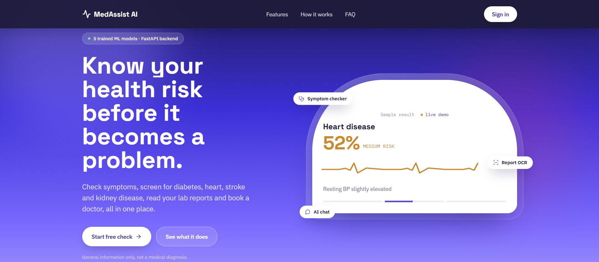
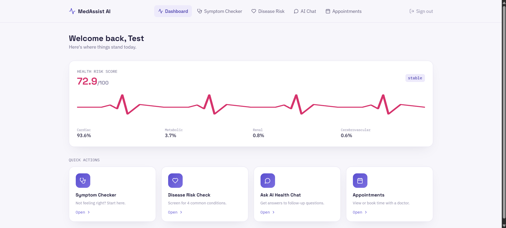
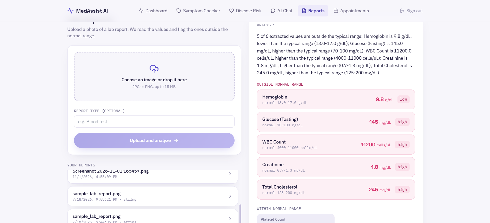
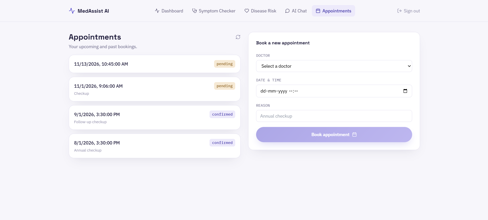

# MedAssist AI

An AI-assisted healthcare platform prototype. Patients can screen for four chronic conditions, check symptoms, upload lab reports for automatic reading, chat with an assistant and book doctors. Doctors and admins get role-based access to the same data.

> **Status:** personal portfolio project. It is not a medical device, and its predictions are screening hints, not diagnoses. See [Limitations](#limitations).

## Screenshots

| Landing page | Dashboard |
|---|---|
|  |  |

| Lab report analysis | Appointments |
|---|---|
|  |  |

## Features

**Patient web app**
- Sign up and log in (JWT access and refresh tokens)
- Dashboard with a combined health risk score and per-condition scores
- Disease risk check for diabetes, heart disease, stroke and kidney disease, with the factors behind each result
- Symptom checker that ranks possible conditions from selected symptoms (results under 15% confidence are hidden)
- Lab report reader: upload a JPG or PNG, and the values are extracted with OCR and flagged against reference ranges
- Chat assistant (rule-based)
- Appointments: list your bookings, pick a doctor from a dropdown and book a slot

**Available through the API (no web screen yet)**
- Diet and exercise recommendations based on your latest results
- Prescriptions and in-app notifications
- Doctor tools: profile, assigned patients, patient notes
- Admin tools: user management and platform analytics

## Tech stack

| Layer | Tools |
|---|---|
| Backend | Python, FastAPI, SQLAlchemy 2.0, Alembic, Pydantic v2 |
| Database | PostgreSQL, Redis |
| ML | scikit-learn (Random Forest), XGBoost, joblib |
| OCR | Tesseract with a regex parser and reference-range analyzer |
| Auth | JWT, Argon2 password hashing, role-based access control |
| Frontend | React 18, Vite, Tailwind CSS, framer-motion |

## Architecture

The backend is a modular monolith with 13 modules. Each module follows the same layers:

```
router  ->  service  ->  repository  ->  model
(HTTP)     (rules)      (database)      (tables)
```

- Doctors can only read data for patients they are assigned to. This is enforced in the service layer, not only in route decorators.
- Modules talk through events. For example, booking an appointment creates a notification without the appointments module calling the notifications module directly.
- Predictions are stored in one generic `ai_predictions` table, and the health score is computed from the latest prediction of each type.

## Machine learning

| Model | Notes |
|---|---|
| Diabetes, heart disease, stroke, kidney disease | Random Forest or XGBoost on public datasets, evaluated on held-out data (ROC-AUC between 0.82 and 1.00 across the four) |
| Symptom checker | 41-class classifier, 97.6% accuracy on a held-out set |
| Health risk score | Blends the single highest component score (70%) with the average of all available components (30%), so one high-risk condition is never hidden by low ones |
| Recommendations | Rule-based, safety-first |

Things worth knowing:
- The heart disease dataset had an inverted target label. It was found by checking group statistics against clinical expectations, then fixed and retrained.
- The stroke data is about 95/5 imbalanced, so recall matters more than precision there. The model uses `class_weight="balanced"` and a lower alert threshold.
- The kidney model scored close to 100%, so it was cross-validated (5-fold) and the features were checked for leakage before it was trusted.

## Run it locally

You need Python 3.11+, PostgreSQL 16, Redis (or Memurai on Windows) and Node 18+. Tesseract is only needed for report OCR.

**Backend**
```bash
cd backend
python -m venv venv
venv\Scripts\activate          # Windows. On Linux/macOS: source venv/bin/activate
pip install -r requirements.txt
# create .env with DATABASE_URL, SECRET_KEY and (optional) TESSERACT_CMD
alembic upgrade head
uvicorn app.main:app --reload
```
API docs: http://127.0.0.1:8000/docs

**Frontend**
```bash
cd frontend
npm install
cp .env.example .env           # Windows: copy .env.example .env
npm run dev
```
Open http://localhost:3000. The backend must be running, and `http://localhost:3000` must be allowed in its CORS settings.

New accounts need `is_verified = true` in the database, since email/OTP verification is not implemented yet.

## Limitations

- **Not clinically validated.** Models are trained on public datasets and were not reviewed by clinicians. Use results as hints only.
- **Symptom checker is low-confidence for vague input.** With only one or two symptoms, probabilities are small, so results under 15% are hidden and the app asks for more symptoms instead.
- **Chat assistant is rule-based**, not a language model.
- **OCR uses Tesseract with a fixed list of 12 lab tests.** Production would need table-aware OCR (such as PaddleOCR) for general layouts.
- **No email/OTP verification, rate limiting or audit logging yet.**
- **No doctor or admin screens in the web app**, only API endpoints.
- **No automated test suite yet**, and it has not been deployed.

## Roadmap

- Recommendations page (diet and exercise) in the web app
- Doctor and admin dashboards
- pytest suite and CI
- Rate limiting, audit logs and email verification
- Deployment (frontend on Vercel, backend on Render, database on Neon)

## License

See [LICENSE](LICENSE).
